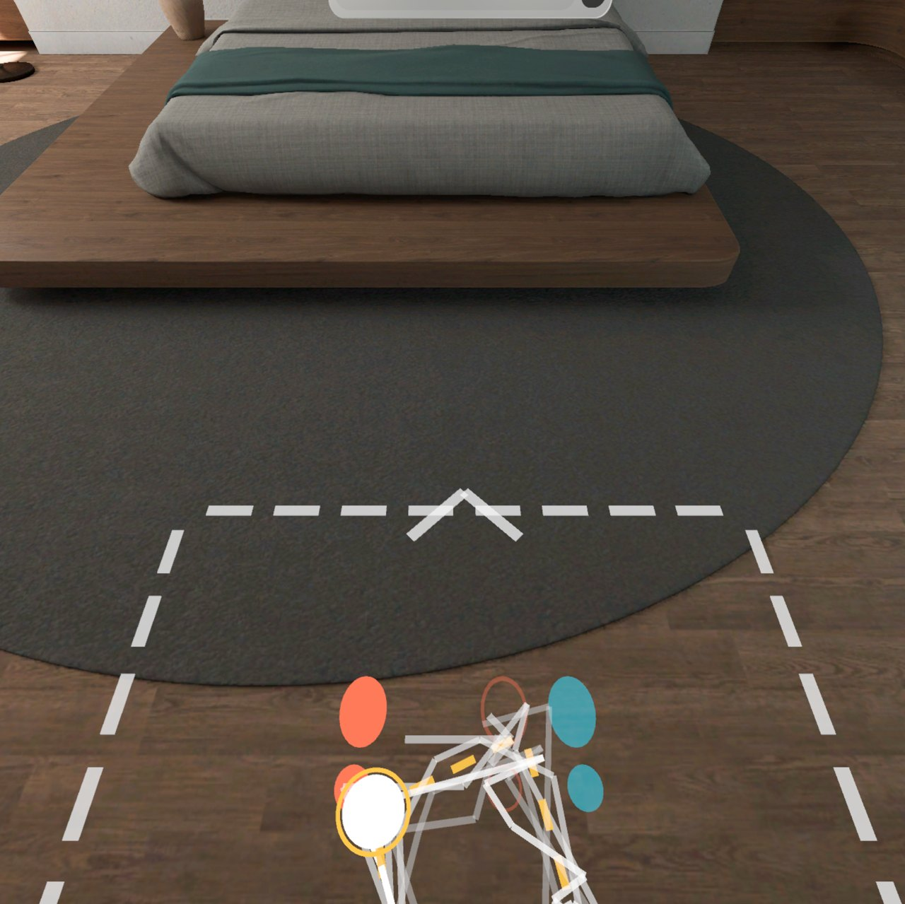
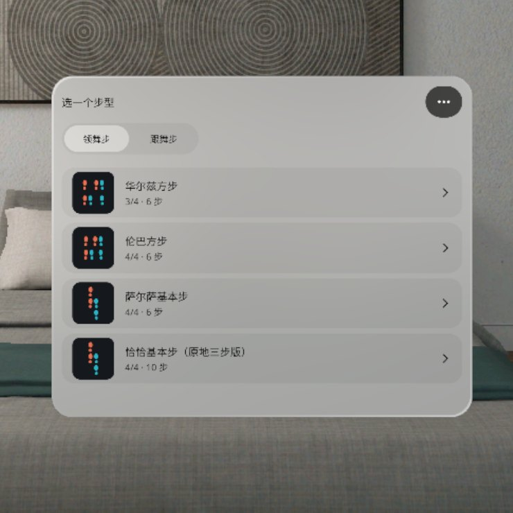
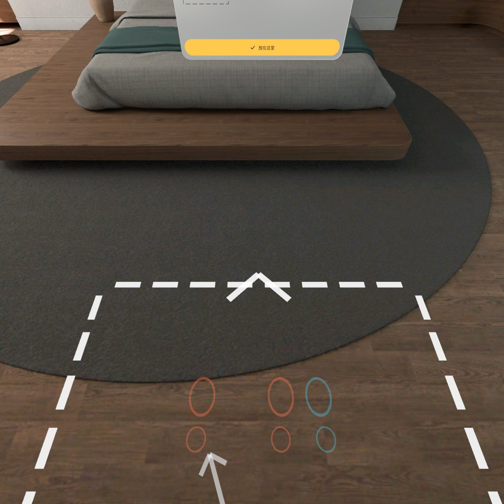
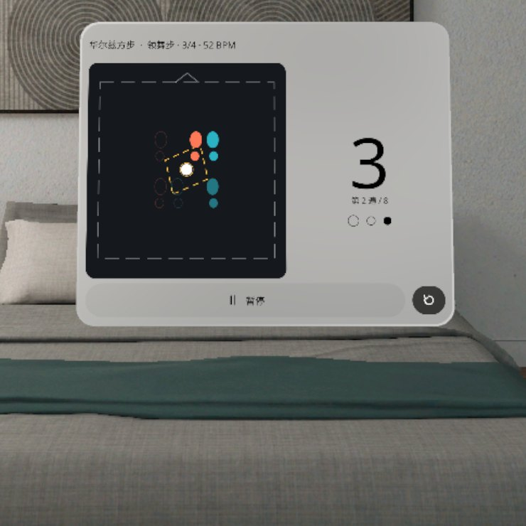
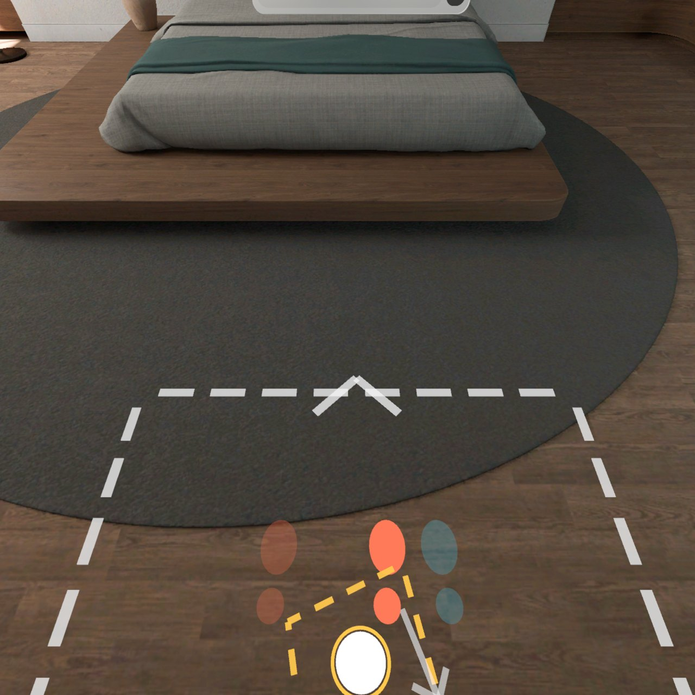
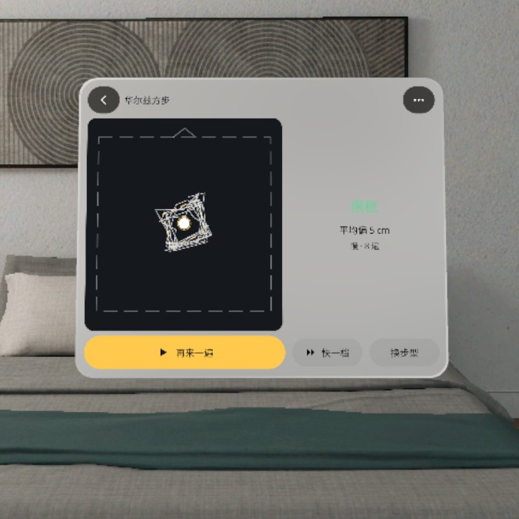
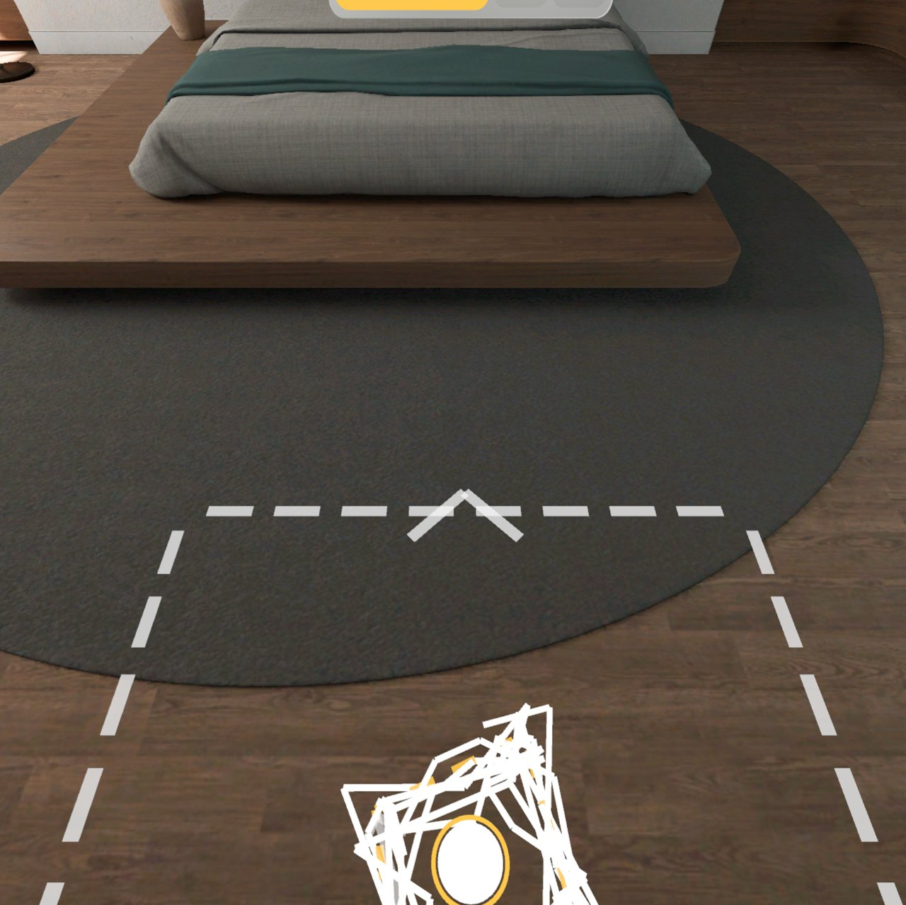
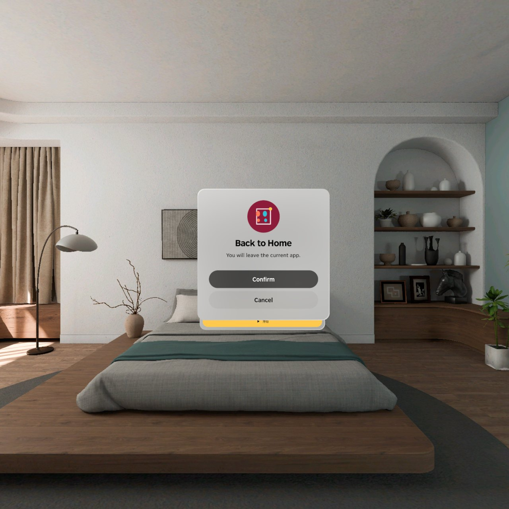

<p align="center"></p>

# Dance Steps | 舞步地图

**交谊舞 / 拉丁舞基本步的脚印 1:1 铺在你家地板上跟拍子亮，视线高度的镜子面板告诉你下一步，跳完画出你的路线。**

**The footprints of a ballroom / Latin basic step lie life-size on your own floor and light up on the beat; an eye-level "mirror" panel shows the next step so you never look down, and at the end it draws the route you danced.**

PICO OS 6 · PICO Spatial SDK 6.1.9 · Kotlin / SpatialUI · package `io.embodit.dancesteps` · v0.1.1 (pre-release / 预发布)

> **v0.1.0 模拟器 QA 通过并在头显上试过；v0.1.1 是按头显反馈的打磨版（脚印形状、踏步声）。**
> **v0.1.0 passed simulator QA and was tried on a headset; v0.1.1 polishes what that run found (footprint shape, step sound).**



> 截图和演示视频来自原生模拟器（PICO Emulator 6.1），由调试广播驱动跳转到各设计状态，跳舞的人是程序合成的「合成舞者」；**非真实手势录像**。
> Screenshots and the demo video were taken on the native PICO emulator, driven by debug broadcasts; the dancer is a synthetic debug walker; **not a recording of real hand gestures or a real person.**
>
> 音乐、预备拍提示音和踏步声全部由程序合成（不含任何外部音频素材），没有数拍人声。
> The music, the count tick and the step sound are all synthesised in code (no third-party audio); there is no counting voice.

---

## 中文

### 这是什么

选一个步型：华尔兹方步、伦巴方步、萨尔萨基本步、恰恰基本步（原地三步版），领舞步或跟舞步。在空地上摆一个 1.5×1.5 米的舞池（舞池朝向在 8° 以内会自动贴平最近的墙），地板上就铺出 1:1 的脚印和金色路线。

开始后先数一小节预备拍，然后脚印跟着拍子亮：当前这一步全亮，下一步半亮，中间有箭头。舞池前方视线高度立着一块「镜子」面板，小地图上有幽灵脚和你的位置，大数字显示拍子和「第 n 遍 / 8」，不用低头看脚。你的头在地面上的投影画出白色轨迹；跳满 8 遍后，地上和小地图只剩标准路线和你整次的轨迹，再给一句结论（很稳 / 还行 / 再慢一点 / 步子再大一点）和平均偏差。速度分慢 · 中 · 快，可以先「看一遍」。中英双语，全部本机保存，不联网。

### v0.1.1 改了什么（头显试用反馈）

> 「dance 脚步那个看不懂，是我自己双脚左脚红色右脚蓝色吗，至少左右脚形状有区别吧，然后踏步音效好奇怪改下」

- **脚印一看就是左右脚**：原来是两个椭圆（脚掌 + 脚跟），左右几乎一样。现在是真正的脚底轮廓 + 五个脚趾，大脚趾在内侧，左右脚互为镜像，脚趾指向就是脚尖方向；颜色（左珊瑚红、右青蓝）只是辅助。地上、镜子小地图、步型缩略图、摆舞池的小图用的是同一个形状。
- **第一次出现时有图例**：放好舞池后旁边弹一句「这是你的左脚 / 右脚，踩上亮着的那个」（带左右两只脚的图），点「知道了」收起；之后镜子小地图下面常驻一行小图例：左脚 · 右脚 · 白边 = 下一步 · 金点 = 重心。（老用户升级后也会再看到一次。）
- **下一步更清楚**：下一步的脚印半亮 + 白色描边；箭头从这只脚**现在站的位置**指到它要落的位置，颜色跟这只脚一样（原来箭头是从另一只脚画过去的，容易看反）；原地换重心的步子没有箭头，看金色「重心点」沿金线移动。预备拍期间第一步就已经亮好、箭头已经指好。
- **领舞 / 跟舞**：地上永远只铺你自己这一角色的脚（没有舞伴的脚），所以不需要第二套样式；角色写在镜子标题里（「领舞步 / 跟舞步」）。
- **踏步声换了**：每一步落脚时有一声很轻的「木地板软底鞋」声（低频闷响 + 一点点摩擦声，音量在音乐之下），和拍子对齐，恰恰的「&」半拍也有。预备拍原来是 1000/1500 Hz 的「哔」，改成柔和的木槌音；底鼓原来起音接近 2 kHz 像「biu」，改成 120 → 50 Hz；牛铃从方波改成两个正弦泛音；沙锤 / 刮瓜的噪声原来每 10 ms 重复一次会发出 100 Hz 嗡声，已修。**更多 → 「踏步声：开 / 关」** 可以关掉踏步声（音乐照常）。
- **扫不到地面也能用**（产线规范 D7）：开场 5 秒还没识别到地面，就先用「头高 − 1.55 m」的估计地面，提示「没扫到地面，先用估计的地面 · 更多里可调高低」；**更多 → 地面高低 ▲▼** 每次 2 cm（真实地面识别到后也能微调）。识别到真实地面后自动换成真实的。

### 音频来源

全部声音都是 `platform/audio/BeatEngine.kt` 里用数学公式实时合成的（正弦 / 三角波、带包络的噪声、一阶低通），没有采样、没有下载任何音频文件，所以没有第三方版权或许可问题。

### 安装与启动

```bash
adb install -r DanceSteps-v0.1.1.apk
pico-cli app launch io.embodit.dancesteps
```

APK 在 [Releases](https://github.com/kejing-dev/DanceSteps/releases) 页面下载（仓库不含 APK）。需要 PICO OS 6 头显或 PICO Emulator 6.1；用到地面识别和头部位置。APK 约 34 MB。

### 容器与骨架

- **容器**：只有 Full Space · `STAGE_MIXED`（透视），没有 Shared Space 版本。脚印要 1:1 铺在真实地板上，你的位置来自头部在地面上的投影，地面识别和头部位姿只在 Full Space 可用。
- **骨架 D**（同火情预案 Fire Plan / 空间尺 Spatial Ruler）：平面识别、头部位姿、懒跟随面板、面板池、摇杆输入。开场的 3D 网格排队分帧生成，避免主线程卡住；音乐和节拍器在应用里实时合成。
- **状态**：设计包 18 个状态（9 个阶段 + 叠加 / 模式），全部可由调试广播直接跳转并截图，结构见 [AGENTS.md](AGENTS.md)。

### 截图

| | |
|---|---|
|  |  |
| 选步型 — 华尔兹 / 伦巴 / 萨尔萨 / 恰恰 | 摆舞池 — 白色虚线方框跟着你走 |
|  |  |
| 镜子面板 — 幽灵脚、大数字拍子、第 2 遍 / 8 | 地板 — 当前脚印亮，下一步半亮 + 箭头 |
|  |  |
| 结果 — 「很稳 · 平均偏 5 cm · 慢 · 8 遍」 | 结果 — 标准路线 + 你整次的轨迹 |

启动器图标：



### 已知问题（QA 第 1 轮，不影响使用）

- 摆舞池碰到墙或家具时，镜子上多出的那行橙色提示字在浅色玻璃上太淡，几乎看不清；橙色边框照常亮。
- 镜子右栏的小字（领舞步 / 跟舞步、慢 · 中 · 快、BPM）离 1.5 米看偏小；大数字和小地图清楚。
- 空闲模拟器上首次打开约 18 秒才到选步型：3D 模型排队生成（防「没有响应」），头显上会快很多。
- 选步型列表里的「上次结果」在默认距离看不清具体字。
- 没有数拍人声：没有授权干净的人声采样，按设计不做，菜单里也没有这个开关。

还没在头显上验过：真人踩脚印（模拟器里用合成舞者和调试移动代替）、音乐和拍子听起来对不对、手柄摇杆转舞池、捏合点按钮的手感、真实房间里地面识别的速度和碰到家具的提示是否准确。

---

## English

### What it is

Pick a step: waltz box, rumba box, salsa basic or cha-cha basic (in-place triple version), as leader or follower. Place a 1.5 × 1.5 m dance floor in a clear spot (it snaps square to the nearest wall within 8°) and the life-size footprints and a gold route appear on your floor.

After one bar of count-in the footprints light up on the beat: the current step fully lit, the next one half lit with an arrow between them. An eye-level "mirror" panel stands ahead of the dance floor with a mini-map of ghost feet and your position, a big beat number and the repetition count out of 8, so you never have to look down. Your head's floor point draws a white trail; after 8 repetitions only the reference route and your whole trail remain, with one verdict (steady / okay / slow down / bigger steps) and the average offset. Slow, medium and fast tempos, plus a preview run. Chinese and English; everything stored on the device, no network.

### What changed in v0.1.1 (headset feedback)

- **Left and right feet you can tell apart**: the footprints were two ellipses (ball + heel) that looked the same on both sides. They are now a real sole outline with five toes, big toe on the inside, so the left and right feet are mirror images and the toes show which way the foot points; colour (left coral, right cyan) only helps. The floor, the mirror's map, the picker thumbnails and the placing picture share the same shape.
- **A legend the first time**: once the floor is placed a bubble beside the mirror says "These are your left / right feet — step on the lit one" (with a left and a right foot), dismissed with "Got it"; after that a small legend stays under the mirror's map: left · right · white edge = next · gold dot = weight. (It shows once again after the upgrade.)
- **The next step is clearer**: the next footprint is half lit with a white edge; the arrow runs from where *that* foot stands now to where it lands, in its colour (it used to start at the other foot); weight changes in place have no arrow, the gold weight dot moving along the gold route shows them. During the count-in the first step is already lit with its arrow.
- **Leader / follower**: the floor only ever shows your own role's feet (no partner's feet), so no second style is needed; the role is in the mirror's title.
- **New step sound**: every landing has a quiet soft-sole-on-wood step (a low thump and a little scuff, below the music), on the beat including the cha-cha "&". The count tick was a 1000 / 1500 Hz beep and is now a soft mallet; the kick started near 2 kHz ("pew") and now sweeps 120 → 50 Hz; the cowbell is two sine partials instead of square waves; the shaker / guiro noise repeated every 10 ms (a 100 Hz buzz), fixed. **More → "Step sound: on / off"** turns the step sound off (the music stays).
- **Works without a floor scan** (factory rule D7): if no floor is found 5 s after start, an estimated floor (head height − 1.55 m) stands in with "No floor found · using an estimate (adjust in More)"; **More → Floor height ▲▼** moves it in 2 cm steps (also for a scanned floor). A real floor replaces the estimate as soon as one is found.

### Audio sources

Every sound is synthesised live from formulas in `platform/audio/BeatEngine.kt` (sine / triangle waves, enveloped noise, a one-pole low-pass); no samples, no downloaded audio, so no third-party copyright or licence applies.

### Install and launch

```bash
adb install -r DanceSteps-v0.1.1.apk
pico-cli app launch io.embodit.dancesteps
```

Download the APK from the [Releases](https://github.com/kejing-dev/DanceSteps/releases) page (the repository itself does not ship an APK). Needs a PICO OS 6 headset or PICO Emulator 6.1; uses floor detection and head pose. The APK is about 34 MB.

### Container and skeleton

- **Container**: Full Space only, `STAGE_MIXED` (passthrough); no Shared Space version. Footprints must lie life-size on the real floor and your position comes from your head's floor point; floor detection and head pose are Full Space only.
- **Skeleton D** (same as Fire Plan / Spatial Ruler): plane detection, head pose, lazy-follow panel, panel pool, thumbstick input. Startup 3D meshes are queued across frames so the main thread never stalls; music and the metronome are synthesised live in the app.
- **States**: 18 designed states (9 phases plus overlays / modes), each reachable by a debug broadcast and captured; see [AGENTS.md](AGENTS.md).

### Screenshots

See the table above: step picker, placing the floor, the mirror while dancing, the lit footprints, and the result on the mirror and on the floor.

### Known issues (QA round 1, none blocking)

- When the dance floor touches a wall or furniture, the extra orange hint line on the mirror is too faint on the light glass; the orange edge still lights up.
- The small text in the mirror's right column (leader / follower, tempo, BPM) is small at 1.5 m; the big beat number and the mini-map read fine.
- On an idle emulator the step picker takes about 18 s to appear on first launch, because startup meshes are queued; a headset is far faster.
- The "last result" line in the step list cannot be read at the default distance.
- No counting voice: there is no cleanly licensed voice sample, so by design it is left out and the menu has no switch for it.

Not yet verified on a headset: a real person stepping on the footprints (the emulator used a synthetic walker and debug moves), whether the music and beat sound right, thumbstick rotation of the floor, the feel of pinching buttons, floor detection speed and furniture hints in a real room.

---

## License

Source code © 2026 Embodit. All rights reserved (private repository). Bundled fonts Noto Sans / Noto Sans SC (subset) are under the SIL Open Font License, see `third_party/`. Music, the count tick and the step sound are synthesised in code (see "Audio sources"); no third-party audio.
